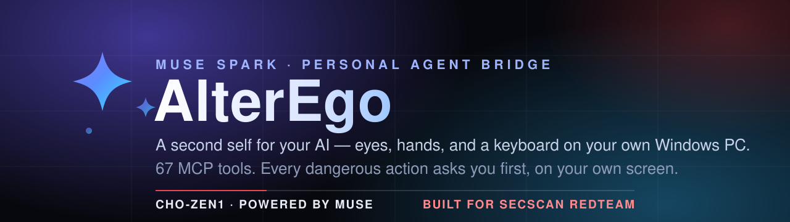
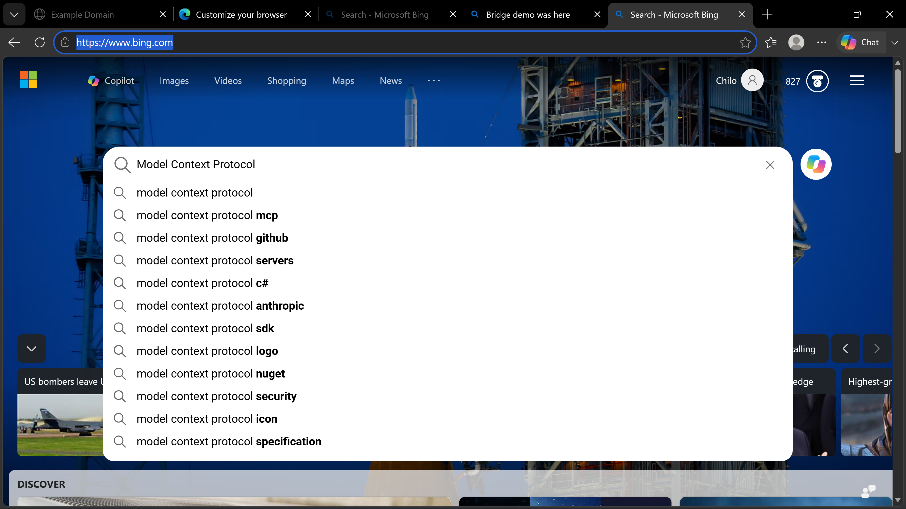
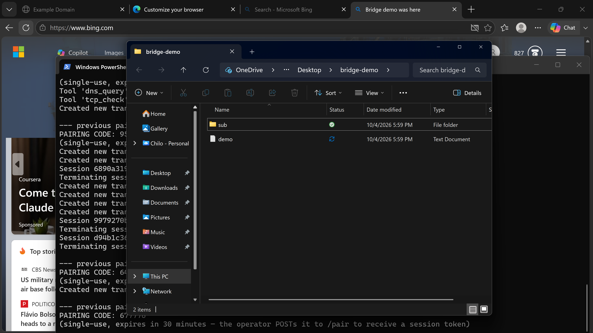

<p align="center">
  
</p>

# AlterEgo — the bridge that gives Muse hands

**AlterEgo gives a Muse agent a second self on a Windows PC.** Not a sandbox.
Not a screenshot API. A real operator's seat: the agent sees your screen,
drives your mouse and keyboard, runs shells, manages files, and drives a real
browser — through **67 MCP tools** — while every dangerous action pops a
native **Yes/No dialog on your own screen** that *you* answer.

It was built for one specific partnership: **Cho-zen1**, a personal agent
running on **Muse Spark**, works as chief developer for the **SecScan
RedTeam** — and AlterEgo is how that agent reaches out of the chat window
and into a real machine to do real work. The human keeps the final say on
everything.

> The PC half listens on **loopback only** (`127.0.0.1:8765`) and is reached
> through a named Cloudflare tunnel the PC owner starts themselves
> (`pc-bridge` → `https://pc.secscan.info`). Nothing phones home; the PC
> only ever dials out.

<p align="center">
  <a href="https://www.python.org/downloads/"></a>
  <a href="docs/setup.md"></a>
  <a href="docs/tools.md"></a>
  <a href="https://modelcontextprotocol.io"></a>
  <a href="demo-evidence/"></a>
</p>

---

## See it work

Proof lives in [`demo-evidence/`](demo-evidence/) — screenshots captured
during real sessions: the agent clicking and filling forms in a live
browser, managing files, driving a terminal, and chatting with the PC
through the built-in WebSocket chat.




---

## How it works (plain words)

1. **You** run the agent server on your Windows PC. It listens on
   **loopback only** (`127.0.0.1:8765`) — unreachable from the network.
2. Your PC dials **out** through a named Cloudflare tunnel you start
   yourself (`cloudflared tunnel run pc-bridge`), which publishes the
   permanent address `https://pc.secscan.info`.
3. The server prints a **6-digit pairing code**. You hand that code to the
   operator — it's safe to share: cryptographically random, single-use,
   expires in 30 minutes, and pairing locks after 5 wrong guesses (and
   stays locked until you re-arm it). The operator exchanges it at
   `POST /pair` for a session **bearer token** over TLS.
4. From then on the agent drives your PC through MCP (Streamable HTTP):
   - **Read tools** (screenshot, window list, profile files, system info)
     run silently — no prompts.
   - **Write tools** (`type_text`, `shell_exec`, `write_file`, …) each pop
     a native Windows **Yes/No approval dialog on your screen** showing
     the exact action. 30 seconds with no answer = **denied**. No
     interactive session = fail closed.
   - **Destructive tools** (`shell_exec`, `shell_pwsh`, `kill_process`,
     `write_file`, `delete_file`, `browser_eval`, `power`, `batch`) always
     get a DESTRUCTIVE-titled dialog — even in auto-approve mode.
5. Session tokens are **persisted on the PC**
   (`%APPDATA%\pc-mcp-bridge\session_token`) so they survive restarts.
   Multiple paired clients can hold tokens at once; revoke one with
   `POST /revoke`, all with `POST /logout`, or delete the token file —
   deleting it revokes access **instantly**, even while the server runs.
6. Every call — read and write — is appended as a typed event to an
   **event-sourced operation log** (`%APPDATA%\pc-mcp-bridge\events\`, one
   JSONL file per day), queryable with `query_events` and replayable with
   `replay_session`.
7. Long work doesn't need the operator to babysit a connection: the
   **job layer** (`submit_job` / `job_status` / `job_result` /
   `job_cancel`) journals a call, executes it on the PC in the
   background, and deduplicates resubmissions by idempotency key.
8. There's also a **WebSocket chat** (`/ws`, UI at `/chat`) so the
   operator, the PC-side agent, and you stay in one conversation.

Full detail: [docs/architecture.md](docs/architecture.md).

---

## Quickstart

**PC owner (Windows):**

```powershell
git clone https://github.com/cc4480/alterego
cd alterego
python -m venv pc-agent\.venv
pc-agent\.venv\Scripts\python.exe -m pip install -r pc-agent\requirements.txt
pc-agent\.venv\Scripts\python.exe pc-agent\server.py   # prints your pairing code
cloudflared tunnel run pc-bridge                       # second terminal
```

The agent gets **its own virtual environment** on purpose: the bridge is
written against the `mcp` **2.x** API (`mcp>=2.0` in
`pc-agent/requirements.txt`), and a shared Python with other MCP tooling
pinned to `mcp<2` will break one side or the other. Full walkthrough —
autostart, watchdog, permissions postures:
[docs/setup.md](docs/setup.md).

**Operator (any MCP client, or the bundled CLI):**

```bash
export PC_BRIDGE_URL=https://pc.secscan.info
python3 bridge/op_call.py health              # tunnel / server / token, layer by layer
python3 bridge/op_call.py pair 279416         # exchange the code; token saved (0600)
python3 bridge/op_call.py tools               # 67 tools
python3 bridge/op_call.py call system_info '{}'
```

Full operator guide: [docs/operator.md](docs/operator.md).

**No PC?** Try the mock: [Quick test](#quick-test-no-pc-needed).

---

## Security model (the short version)

- **Loopback only.** The server binds `127.0.0.1`. The only inbound path
  is the outbound Cloudflare tunnel the PC owner starts.
- **Pairing, not pre-shared secrets.** No long-term secret is ever
  distributed. The tunnel URL is just an address — the bearer token is
  the authentication, compared in constant time on every request.
- **Approval-gated writes, tiered by risk.** Every tool carries a
  machine-readable risk profile (blast radius, recoverability, side
  effects, compensating action). Reads are silent; ordinary writes ask;
  destructive tools always ask with a DESTRUCTIVE title. Unknown tools
  fail closed to the strictest tier.
- **Permission postures** (`PC_BRIDGE_PERMISSION_MODE`): `default`
  (reads silent, writes ask), `plan` (writes become dry-runs — no side
  effects), `acceptEdits` (file edits auto-approved; shell and
  destructive tools still ask), `dontAsk` (no dialogs at all — for the
  owner's own unattended operation; the server demands an on-PC
  confirmation click at startup, and the audit log still records
  everything).
- **Owner-side policy hooks.** PreToolUse / PostToolUse hooks
  ([pc-agent/HOOKS.md](pc-agent/HOOKS.md)) and a command allow/deny list
  (`command_rules.json`) let the PC owner inject custom rules — e.g.
  deny deletes on a specific drive — without touching tool code.
- **Emergency stop.** Drop a file named `ESTOP` next to the job journal
  and all new job execution pauses (queued work waits; running work is
  never killed). Delete the file to resume.
- **Full audit trail.** Every tool call lands in the event log with its
  risk snapshot; secrets are redacted before they are written.
- Read tools are restricted to the user's own profile directory; Windows
  system directories and other users' profiles are denied.

Full model: [docs/security.md](docs/security.md) ·
every knob: [docs/configuration.md](docs/configuration.md).

---

## Documentation

| Doc | What's in it |
|---|---|
| [docs/architecture.md](docs/architecture.md) | How the pieces fit: server, seams/providers, tool pipeline, job layer, event log, chat |
| [docs/setup.md](docs/setup.md) | PC owner: install (venv rule), tunnel, autostart, watchdog, daily use |
| [docs/operator.md](docs/operator.md) | Operator: health checks, pairing, CLI, job mode, protocol notes |
| [docs/tools.md](docs/tools.md) | The full catalog: all 67 MCP tools, grouped, with arguments and approval behavior |
| [docs/security.md](docs/security.md) | Pairing, tokens, approval tiers and postures, hooks, ESTOP, revocation |
| [docs/configuration.md](docs/configuration.md) | Every environment variable, `command_rules.json`, data-directory layout |
| [docs/troubleshooting.md](docs/troubleshooting.md) | Field-proven diagnoses, including "tunnel up, server down" |
| [docs/development.md](docs/development.md) | Repo layout, adding a tool, running the test suites, the mock provider |

---

## Layout

- `pc-agent/` — the Windows half. MCP server (Streamable HTTP) on
  `127.0.0.1:8765`, pairing + bearer-token auth, native approval dialogs,
  the seams/provider tool implementations, the job layer, the
  event-sourced operation log, and the WebSocket chat UI.
- `bridge/` — the operator half. `op_call.py`: the durable stdlib-only
  MCP client CLI (`health`, `pair`, `tools`, `call`, job mode, `logout`);
  `token_store.py`: the saved session token (`~/.config/pc-bridge/token`,
  mode 0600); `mock_mcp_server.py`: a stdlib-only fake PC for testing
  without a PC or tunnel; `demo*.py`: the scripts that produced
  `demo-evidence/`.
- `scripts/` — PC-side PowerShell: scheduled-task autostart installer,
  bridge launcher, and the 5-minute watchdog.
- `docs/` — the documentation set above.

## Quick test (no PC needed)

```bash
cd bridge
MOCK_TOKEN=secret python3 mock_mcp_server.py 8765 &          # fake PC
PC_BRIDGE_URL=http://127.0.0.1:8765 PC_BRIDGE_TOKEN=secret python3 pc_bridge.py tools
PC_BRIDGE_URL=http://127.0.0.1:8765 PC_BRIDGE_TOKEN=secret python3 pc_bridge.py screenshot --out /tmp/shot.png
```

---

## Credits

**Created by Carlos** — who designed and built the bridge so his Muse
agent could genuinely reach into a Windows PC, safely, with the human
always holding the final Yes/No. AlterEgo is the connective tissue of the
SecScan RedTeam build: it's how the agent and the machine work as one.
